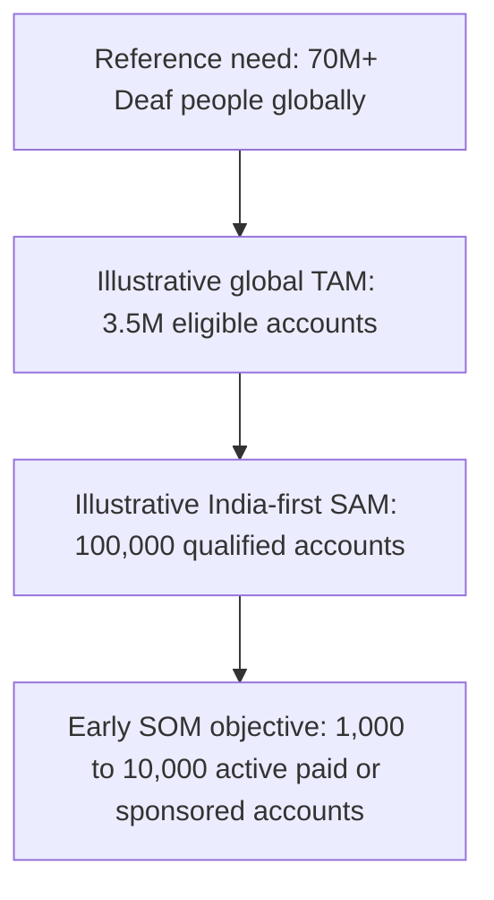

# Ishara — need, market and business model

**Accessible phone conversations are a recurring access need.**

Working market model · 30 October 2026 · [Product](README.md) · [Pitch](PITCH.md)

## Start with the task

At a service whose next step requires a voice call, being able to send text elsewhere does
not make the phone conversation accessible. A person may need to ask someone to help,
wait for their availability and share details with them. Ishara aims to let the person
handle that interaction directly, or delegate a bounded request while retaining decisions.

The initial task is an administrative appointment call. The longer-term opportunity is
repeated access to existing phone-first services. This is a product hypothesis: we have
not measured how often prospective users encounter the barrier or their willingness to pay.

## What the population evidence establishes

| Reference population | Evidence | Correct interpretation |
|---|---|---|
| **70M+ Deaf people globally** | UN, citing WFD [S1] | A global reference population; neither an account forecast nor a count of people who would choose signing. |
| **430M people requiring rehabilitation for disabling hearing loss** | WHO fact sheet, 3 March 2026 [S2] | Broader hearing-loss context, overlapping the Deaf population. Includes children and differing phone-access needs. |
| **700M+ projected to have disabling hearing loss by 2050** | WHO [S2] | A projection of need, not future revenue. |
| **5,071,007 people recorded with hearing disability in India** | Census 2011, reproduced by PIB on 4 August 2015 [S3] | A historical baseline with its own definitions, not current prevalence or a paying market. |

Do not add these populations together. We do not use the economic cost of hearing loss as
software revenue TAM, or assume every person in a reference population needs Ishara.

## TAM, SAM and SOM: an explicit working model

**These are illustrative revenue scenarios, not a validated market-size estimate.**
There are no measured eligibility rates, adoption rates or prices yet. TAM describes the
eligible market if fully served, not a prediction that all eligible accounts will subscribe.



These scenarios describe a future supported product, not the addressable market of the
current eight-word ASL prototype. Global and India prices are separate hypotheses in
different currencies; no exchange-rate equivalence is implied.

### Global TAM sensitivity

Use the **70M reference population**, without adding the broader WHO figure. Assume a
fraction meets all eligibility conditions: relevant recurring tasks, compatible device
and connectivity, supported language, usable interface and payment or sponsorship access.
These fractions are assumptions, not study findings.

Assumed subscription revenue: **$5/account/month = $60/year**, excluding metered call charges.

| Assumed eligible share | Eligible accounts | Revenue at full penetration of that eligible market |
|---|---:|---:|
| 1% | 700,000 | **$42M/year** |
| 5% | 3,500,000 | **$210M/year** |
| 10% | 7,000,000 | **$420M/year** |

Formula: `70,000,000 × eligible_share × $5 × 12`.

The key unknowns are eligibility and sustainable revenue per account. The wider
hard-of-hearing population could expand the opportunity; it is excluded from this
arithmetic to avoid overlap and unsupported expansion.

### India-first SAM hypothesis

Use **100,000 qualified accounts** as a planning assumption for an initial language/device
footprint and reachable distribution. This is not inferred from a measured percentage of
the 2011 Census population. Replace it with partner reach and opt-in demand data.

At a hypothetical **₹199/account/month**, the SAM scenario is
`100,000 × ₹199 × 12 = ₹238,800,000 = ₹23.88 crore/year` in subscription revenue.

Qualifying this cohort requires accessible text/tap entry or evaluated language-specific
sign support, local call reliability, affordable usage and distribution. The current
ASL demonstration alone does not make this cohort serviceable.

### Early SOM objectives

These are milestones to test, not a sales forecast. A time horizon depends on pilot results.

| Active paid or sponsored accounts | Annual subscription revenue at ₹199/month |
|---|---:|
| 1,000 | **₹23.88 lakh** |
| 10,000 | **₹2.388 crore** |

Count each account once, whether a person or institution pays. These are not achieved
user counts. Revenue is not profit: carrier, voice, inference, support, acquisition,
refunds, tax and compliance costs are not deducted.

## Who uses it, who could pay, and how to reach them

| User need | Candidate payer | Distribution experiment |
|---|---|---|
| An individual regularly handles phone-first tasks | Individual or family, subject to affordability | Opt-in pilots through Deaf-led community organizations |
| Accessible communication at work or in education | Employer or institution sponsoring accounts | A bounded pilot with participant consent and privacy rules |
| Access without an individual subscription burden | Accessibility program, NGO or public-sector sponsor | A funded cohort with measured completion and cost |

These are candidate models, not existing partnerships or funding commitments. Organizations
can sponsor the same person-facing product; this does not require building a
hospital-management or enterprise operations system.

## Pricing must survive real call costs

A subscription assumption is not a promise of unlimited calling. Test a small access fee
with metered minutes, sponsored usage credits, or an institution-funded allowance.
Existing free or publicly supported services in some markets affect willingness to pay.

```text
Contribution per account
  = subscription + usage revenue
  - telephony - voice/STT - model inference - variable support/payment costs
```

Measure minutes per completed task, failed attempts, retries and support effort. Fewer
back-and-forth turns could improve effort and cost, but this has not been measured for
Ishara. No price, margin or CAC/LTV claim is validated.

## An existing category, with a specific hypothesis to test

Captioned calls and text-to-speech relay already exist. Google's official Live Caption
documentation describes typed call responses on supported Pixel devices [S4]. Rylo,
formerly Nagish, describes AI captioning and text-to-speech relay and free US service for
eligible people with hearing loss [S5]. Ishara is not claiming to invent text relay or to
be the first accessible calling app.

Ishara's proposed distinction is **switching between person-directed relay and an approved
agent brief, with accessible mid-call decisions and optional sign input**. The hypothesis
is reduced effort for routine service calls while retaining person control. It needs
comparison with typing, device captioning and existing relay services. No head-to-head
advantage has been established.

## What would make this a credible business

| Next evidence | Decision it informs |
|---|---|
| Deaf-led interviews and observed calls, including people who prefer typing | Problem frequency and preferred interaction |
| Repeated use in a small consenting cohort | Value beyond a demonstration |
| Independent completion, corrections, caption errors and unconfirmed outcomes | Whether the access barrier is reliably removed |
| Supported-language/device tests and a separate ISL evaluation | Actually serviceable audience |
| Voluntary paid trials or documented sponsorship interest | Price and payer assumptions |
| Cost per completed task, including failures and support | Sustainable unit economics |

Ishara currently has no Deaf-participant validation, paying users or commercial deployment
evidence. The first milestone is a trustworthy completed conversation and a person who
chooses to use the product again.

## Sources

Checked **30 October 2026**. Population measures have different definitions and dates.

- **S1 — United Nations:** [International Day of Sign Languages](https://www.un.org/observances/sign-languages-day), citing WFD for the 70M+ global estimate.
- **S2 — World Health Organization:** [Deafness and hearing loss](https://www.who.int/news-room/fact-sheets/detail/deafness-and-hearing-loss), dated 3 March 2026.
- **S3 — Government of India, PIB:** [Policy for Disabled](https://www.pib.gov.in/newsite/PrintRelease.aspx?lang=2&reg=48&relid=124291), dated 4 August 2015; table reproduces Census 2011.
- **S4 — Google:** [Live Caption, including typed call responses](https://support.google.com/accessibility/android/answer/9350862?hl=en-AF).
- **S5 — Rylo:** [Nagish is now Rylo](https://rylo.com/post/nagish-is-now-rylo). Provider-reported product and availability claims.

All eligibility fractions, account targets, prices and revenue calculations above are
Ishara planning assumptions. These sources do not endorse Ishara or establish its demand.

[S1]: https://www.un.org/observances/sign-languages-day
[S2]: https://www.who.int/news-room/fact-sheets/detail/deafness-and-hearing-loss
[S3]: https://www.pib.gov.in/newsite/PrintRelease.aspx?lang=2&reg=48&relid=124291
[S4]: https://support.google.com/accessibility/android/answer/9350862?hl=en-AF
[S5]: https://rylo.com/post/nagish-is-now-rylo
