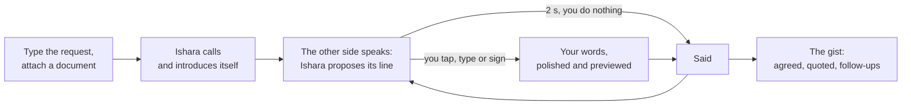

# Ishara — phone calls, made accessible

**Your conversation. Your control.**

Public positioning · 31 October 2026 · [Product and architecture](README.md) · [Market and sources](MARKET.md)

## The problem in one scene

A person needs a doctor's appointment. The clinic says: call us. If you can't hear the
other side, that two-minute call becomes a favour you ask of someone else: on their
schedule, with your health details in their ears. Typing doesn't help on its own, because
the receptionist is still talking.

**Ishara makes that call for you, and keeps you in charge of it.** People reply in the way
that suits them: typing, signing or their own words. Deafness does not mean someone can't
speak, and signing is never a condition of access.

## The 45–60-second pitch

> Every clinic, bank and office says the same thing: call us. For 70 million Deaf people,
> that usually means asking someone else to make the call.
>
> Ishara makes the call for you. Type what it's about, attach anything they might ask
> for, and tap Call. Ishara phones the business, introduces itself, and speaks for you,
> while you read every word, live.
>
> Do nothing, and Ishara handles it: it accepts only what fits your request, answers from
> what you gave it, and checks back on anything else. Want to say something yourself? Tap
> its line and change it, type, or sign. Ishara polishes your words, never adds facts, and
> says them. When the call ends, you get the gist: what was agreed, in their words.
>
> The business just answers its phone. Ishara: your conversation, your control.

## The product at a glance

**In the app today:** typed requests, photo and PDF attachments read on the phone,
captions of both sides, Ishara's proposals with a 2-second bar, stepping in by typing or
signing, polished replies, the lock-screen Live Activity, the gist and Recent calls. Calls
run through the Ishara backend on Heroku and Bolna (Deepgram, Sarvam, Plivo).

## The moments to show

| On the clinic's phone | On the person's phone |
|---|---|
| "Hello, I'm calling for a Deaf caller who is using Ishara…" | Ishara introduces itself first, on every call |
| "Dr. Rao's earliest is Wednesday at 4 pm." | The person asked for mornings; Ishara's line fills its 2-second bar and is said: "Sorry, 4 pm doesn't work for them. Is there anything in the morning?" |
| "I have Thursday at 10:30." | The person taps Ishara's line and adds "I'll bring my BP readings"; Ishara polishes it and says it |
| "Any allergies Dr. Rao should know about?" | Ishara answers word for word from the attached health history: penicillin |
| "You're booked for Thursday at 10:30." | The person signs THANK YOU; the gist opens with the booking quoted |

## Why signing, if someone could type?

They can, and typing is the main way to steer a call. What Ishara adds is the call itself:
the receptionist's voice becomes readable text, and the person's reply becomes speech on
an ordinary phone line. Signing is there for people who prefer it, recognised on the
iPhone with a public ASL model that speaks only when it is confident.

We don't claim that every Deaf person signs, that Deaf people can't speak, or that signing
is faster than typing.

## The opportunity

AI voice agents change the cost of an accessible call. In the US, phone relay for Deaf
callers is funded at **$1.48 billion a year**, and a human video relay minute is
compensated at **$4.07–$8.06**; an AI voice agent starts at **$0.06 a minute** before
telephony. India has about **50 lakh** Deaf people and **fewer than 300** certified sign
language interpreters. Sources are in [MARKET.md](MARKET.md).

Ishara starts in India. Distribution runs through Deaf-led organisations, accessibility
programmes and employers, with individual and sponsored subscriptions. A global scenario of
**3.5M eligible accounts at $5/month is $210M a year**; eligibility and price are planning
assumptions, with lower and higher cases in MARKET.md.

## Judge questions: direct answers

| Question | Answer |
|---|---|
| Why not type? | You do. Typing is the main input; Ishara turns the call into text you read and your text into speech the business hears. |
| Why not ask a friend? | Someone has to be free, and they hear everything. Ishara lets the person make the call themselves, when they need to. |
| Aren't captioned calls already available? | Captions show what was said. Ishara also speaks for you, handles the routine turns, and brings decisions back to you. |
| What stops the agent from making things up? | It says only what you gave it. A fact-checker blocks any day, time, number or name you didn't provide; documents are quoted word for word and only when asked; anything else is deferred and saved as a follow-up. |
| Why an AI agent? | So the person doesn't have to compose every turn. They steer when it matters and let Ishara handle the rest. |
| Why Bolna? | Phone calls, Indian voices (Sarvam), Deepgram transcription and a custom-LLM hook, so every word Ishara says comes from our backend's rules. |
| Whose number does the clinic see? | Ishara's calling number, a Bolna number, not the person's own. Ishara says who it is at the start of every call. |
| Is this Indian Sign Language? | Signing is ASL today, with a public model. ISL is a separate language; it comes next, built with Deaf partners and ISL data. |
| Is the booking definitely in the clinic's system? | Ishara reports exactly what the receptionist confirmed, quoted in the gist. It doesn't connect to the clinic's booking system. |
| How do you make money? | Individual and sponsored subscriptions, priced well below human relay because an AI minute costs a fraction of a human one. |

## What's next

- **Indian Sign Language** with Deaf-led partners, and more signs.
- **Hindi and regional languages**, using Sarvam's Indian voices.
- **Calls from the person's own number**, alongside Ishara's calling number.
- **Pilots with Deaf participants** to measure independent completion, corrections,
  preferred input and recurring use.
