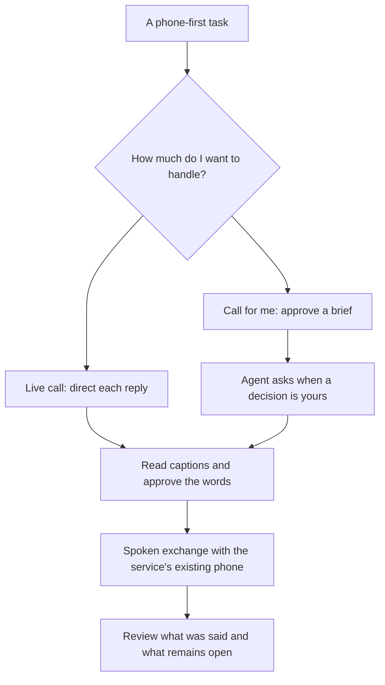

# Ishara — phone calls, made accessible

**Your conversation. Your control.**

Current public positioning · 30 October 2026 · [Product](README.md) · [Market and sources](MARKET.md)

## The problem in one scene

A person needs an appointment. The service's next step is a phone call. If the person
cannot reliably hear the response, the task can depend on someone else's availability.
Now there are two schedules to coordinate and someone else in a personal conversation.

**Ishara's purpose is to make that conversation accessible and independently directed.**
People have different preferences for expressing their replies: typing, signing, buttons,
or their own speech. Deafness does not imply an inability to speak, and signing should
not be a condition of access.

## The 45–60-second pitch

> A lot of everyday services still begin with “Call us.” For Deaf and hard-of-hearing
> people, that can mean finding someone available to help make the call, and depending
> on them to carry a personal conversation.
>
> Ishara makes the conversation readable and lets the person direct what happens next.
> Read the other side as captions, approve a spoken reply, or approve a brief and let an
> agent handle the call while bringing decisions back to you. The business answers its
> existing phone.
>
> Today we're demonstrating a person answering a receptionist's question through a
> supported sign while the agent stays on the line. Our product direction includes
> typing and buttons alongside signing, so people can use the input that works for them.
>
> Ishara: your conversation, your control.

## The product at a glance

**Built now:** signs and tap choices, captions, SEND in live relay, approved briefs,
delegated questions, transcripts and local call history.

**Next:** general typed replies and camera-free entry. These are product commitments to
input choice, not features being claimed as shipped. Delegated questions currently accept
fixed choices rather than arbitrary typed answers.

## The moment to demonstrate

| On the service's phone | On the person's phone |
|---|---|
| “What time would you like to come in?” | The question appears as a caption. |
| “One moment, please.” | Ishara asks the person to choose an answer. |
| The receptionist waits. | The person signs **TOMORROW**, or taps it. |
| “Tomorrow, please. What times are available?” | Their choice has shaped the live conversation. |

The proof is that a real question crosses the voice barrier and a person-controlled reply
crosses back. An appointment is only confirmed when the receptionist actually confirms it.
The current acceptance-only booking label and early hangup need correction before using
the notes screen as proof of a confirmed booking. Text handed to Bolna is not an audio
playback acknowledgement.

## Why signing if someone could type?

Typing is valid. It does not turn the receptionist's voice into readable text or carry a
message into an ordinary phone line on its own. The accessible call is the core value.
Signing is an optional input for people who prefer it, with its usefulness still to be
tested in real tasks. In the current prototype, a tap can be the better choice for YES/NO.

Do not claim that every Deaf person signs, that all Deaf people cannot speak, or that
signing is always faster than typing. The present isolated-word recognizer does not
establish natural-language fluency or a writing-effort advantage.

## The opportunity and the first customers

The [market model](MARKET.md) starts with a recurring task: people who need to contact a
phone-first service and cannot reliably use its spoken replies. The initial geographic
focus is India, subject to language, device and accessibility validation. The current
ASL demonstration does not establish an India-ready ISL product.

Potential distribution is through Deaf-led organizations, accessibility programs and
employers, with individual or sponsored accounts. These are routes to test; there are no
claimed partnerships, paying customers or commercial deployments.

A global scenario of **3.5M eligible accounts at $5/month is $210M annual subscription
revenue**. Eligibility and price are assumptions, with lower and higher scenarios in
MARKET.md. Population size is evidence of the scale of the need; adoption must be earned.

## Judge questions: direct answers

| Question | Answer |
|---|---|
| Why not type? | People should be able to. Captions, speech relay and delegation remain useful with typed input. General typing is the next input path; this build demonstrates signs and taps. |
| Why not ask a friend? | That requires someone to be available and may put them inside a private conversation. Ishara aims to let the person handle the task when they need to. This scenario still needs participant validation. |
| Aren't captioned calls already available? | Yes. Existing services and device features validate the category. Our hypothesis is that approved delegation plus accessible mid-call decisions can reduce the work of routine service calls. Comparative superiority has not been established. |
| Why an AI agent? | It can conduct the spoken exchange and pause at decisions, so the person does not need to compose every turn. The approved brief defines its intended authority. |
| Why Bolna? | Its phone calls, graph events and custom-LLM integration connect person-controlled replies to an existing business phone line. |
| Is this Indian Sign Language? | The current recognition demonstration is ASL. ISL requires its own data and evaluation. |
| Can I use it for every call today? | This is an allowlisted hackathon prototype with a small vocabulary, limited verification and known recovery/outcome issues. |
| Is the booking definitely in the clinic's system? | Ishara can report what the receptionist said. It has no integration that independently verifies the clinic's booking system. |
| How do you make money? | Test individual access and sponsored accounts with metered usage. Prices and market scenarios are assumptions; provider cost and willingness to pay must be measured. |

## Evidence to show, and evidence to earn

Show the real question in captions, the person's actual input and the corresponding
spoken answer. Label simulator footage, saved clips and scripted calls clearly.

Next, work with Deaf participants to measure independent completion, corrections,
confidence, preferred input, recurring use and affordability. Track real call latency,
caption errors and confirmation failures. The current build has no Deaf-participant
validation; the presenter is hearing and learned the demonstrated signs from Lifeprint.

The long-term ambition is reliable, person-directed access to existing phone-first
services. The immediate proof is one readable conversation that a person can steer.
