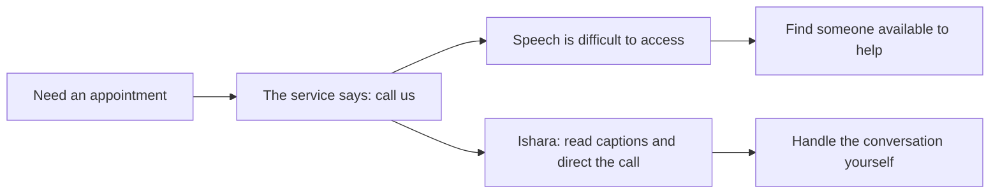
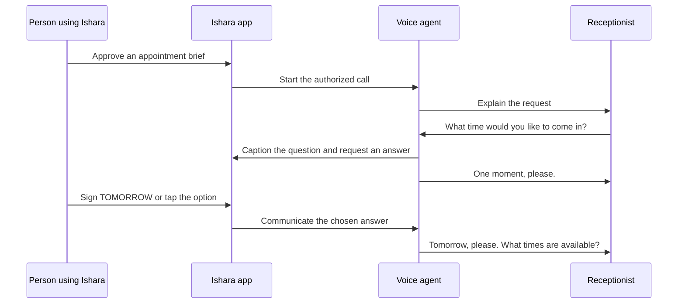
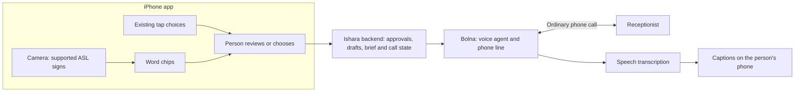

# Ishara

### Phone calls, made accessible. Your conversation. Your control.

**Ishara helps Deaf and hard-of-hearing people handle phone-first services independently.**
Read the other person's words as captions, communicate a reply, or approve a brief and let a
voice agent carry the conversation while bringing decisions back to you. The business uses
its existing phone; it needs no Ishara app or integration.

[The pitch](PITCH.md) · [Market, TAM and business model](MARKET.md) · [Run the app](ios/README.md) · [Run the backend](backend/README.md)

## Why this matters

**“Call us” should not mean “find someone who can call for you.”**

Consider an appointment line that only takes bookings over the phone. For a person who
cannot reliably hear the reply, a simple task can involve finding someone available to
help, coordinating schedules, and sharing a personal conversation. Being able to type a
message does not make the voice-only reply readable.

Ishara's purpose is independence: access when a task needs doing, privacy over the
conversation, and control over what is said and agreed. Signing is one input option in that
vision. People who prefer typing or buttons belong in the same experience.



## A large need, with a focused starting point

| Scale of the need | Source and meaning |
|---|---|
| **70M+ Deaf people worldwide** | UN, citing WFD. A global population estimate, not a customer count. [Source](https://www.un.org/observances/sign-languages-day) |
| **430M people require rehabilitation for disabling hearing loss** | WHO, March 2026. A broader, overlapping population; do not add it to the 70M figure. [Source](https://www.who.int/news-room/fact-sheets/detail/deafness-and-hearing-loss) |
| **5.07M people recorded with hearing disability in India** | Census **2011**, reproduced by PIB in 2015. Historical context, not a 2026 estimate. [Source](https://www.pib.gov.in/newsite/PrintRelease.aspx?lang=2&reg=48&relid=124291) |

Our initial use case is one administrative service call: arranging an appointment.
The opportunity grows through repeated tasks on existing phone lines. The business case
must establish recurring use, language coverage, affordability, and reliable call completion.

A global commercial scenario of **3.5M eligible accounts × $5/month = $210M/year** illustrates
the potential scale. Both eligibility and price are assumptions, not measured demand:
the account count assumes 5% of the 70M reference population fits and can access a future
supported product. See [the full TAM/SAM/SOM model](MARKET.md) for sensitivity, India-first
distribution, costs and what still needs validating.

## Two ways to handle the conversation

| Live call | Call for me |
|---|---|
| Read captions and direct each reply. | Review a short brief and authorize the agent to pursue it. |
| In the current build: sign → word chips → review the draft → **SEND**. Quick replies are also available. | Stay on the call to answer questions by supported signs or taps, or let the agent report back with a callback requirement. |
| SEND approves the displayed sentence. | The brief authorizes the task; on-screen choices steer decisions during the call. |

**Example: answering a question while the agent is on the line**



The person stays inside the conversation. The agent handles the spoken exchange.

## Input choice: current build and next step

| Capability | Status |
|---|---|
| Receptionist captions, live relay, delegated briefs and questions | Implemented |
| Eight eligible ASL sign words, candidate suggestions, recognition abstention | Implemented; thresholds remain provisional |
| Tappable quick replies, brief time preferences, delegated answer options | Implemented |
| Recent calls on the phone and polling for late call summaries | Implemented |
| General typed replies, arbitrary typed delegated answers, camera-free entry | **Planned**; not present in the current app |
| Reliable receptionist-confirmed booking outcomes and audio-playback status | Need hardening; acceptance and text handoff are not proof of completion |

The product direction is **type, sign, or tap, according to the person's preference**.
The present demonstration uses signs and existing buttons. It does not demonstrate a
general typed conversation yet.

## How it works



- **SwiftUI + MediaPipe + LiteRT:** recognition runs on the iPhone; the Mac bridge provides
  a fallback. The ASL model is used as published, without our own training.
- **FastAPI + Groq:** compose drafts with checks and deterministic fallback; coordinate
  approved turns, delegated questions, captions and notes.
- **Bolna + Deepgram + Sarvam + Plivo:** carry the call, transcribe speech and speak the
  backend's replies. Calls currently originate from **a Bolna number**, not the person's own.

## What has been demonstrated

The team recorded successful real Bolna calls on **28 October 2026**, covering live relay,
attended delegation, an open time question and unattended delegation. These used the iOS
simulator with sign videos as camera input and a consenting teammate as receptionist.
They establish a rehearsed integration, not natural-conversation or Deaf-participant validation.

The reviewed source revision is `83c8a33` (29 October). Physical iPhone camera, performance
and final recognition thresholds remain unverified in the available evidence.

The current vocabulary is **hello, thankyou, yes, no, now, please, tomorrow, wait**.
MORNING is tap-only. This is isolated-sign recognition, with hands at rest between signs.
ASL and Indian Sign Language are separate languages; ISL support requires suitable data,
language-specific evaluation and work with Deaf partners. No Deaf participant has yet
validated Ishara. Outcome labels, speech delivery indicators and restart recovery remain
prototype limitations.

## Try it

```sh
scripts/verify.sh
```

- [iOS setup](ios/README.md): the app defaults to a scripted call; nothing is dialled.
- [Backend setup](backend/README.md): `uv run python -m scripts.local_demo` runs a local
  scripted receptionist, with no paid API calls or telephony.
- [Mac recognition bridge](spikes/recognition/README.md): `scripts/sign_lab.sh --free --model asl`.

Live calls need separately authorized use, an allowlisted consenting recipient and provider
configuration. The trial account only dials verified numbers. Credentials, model files and
private recordings are excluded from Git.

## Read more

- [Pitch and judge questions](PITCH.md)
- [Market opportunity, assumptions and sources](MARKET.md)
- [Public submission copy](docs/demo/SUBMISSION.md) and [slide outline](docs/demo/SLIDES.md)
- [Engineering plan](PLAN.md) and [verification guide](docs/TESTING.md)

The older material under `docs/research/`, `docs/archive/` and dated experiment records is
background. The README, PITCH and MARKET files carry the current public positioning.
