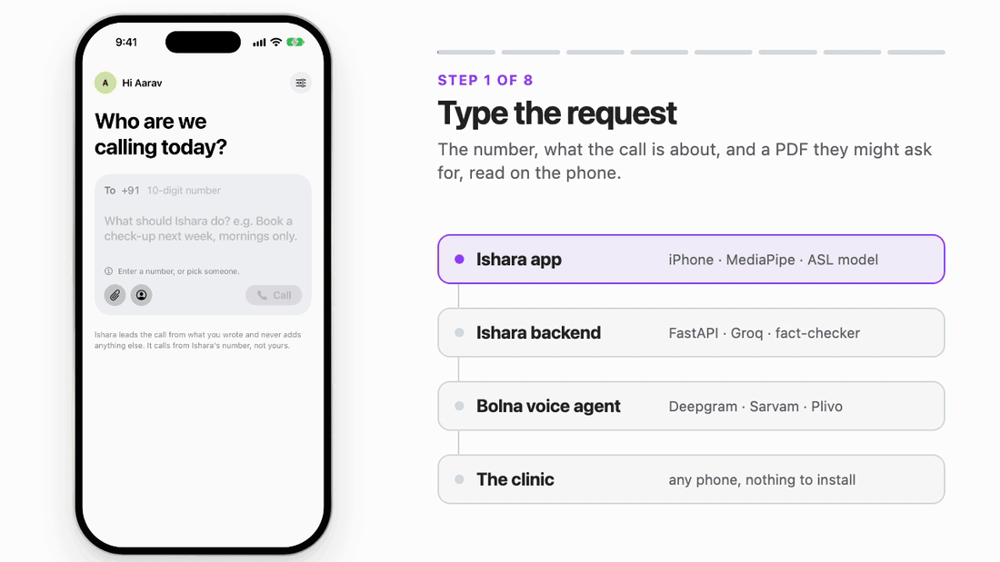

# Ishara

### Phone calls, made accessible. Your conversation. Your control.

[](https://github.com/BishalJena/ishara/actions/workflows/ci.yml)

**Ishara makes phone calls for Deaf and hard-of-hearing people, and keeps them in charge.**
Type what the call is about. Ishara phones the clinic, office or shop, speaks for you and
shows you every word, live. Do nothing, and it handles the call. Type or sign at any
moment, and you steer it. The business just answers its ordinary phone.

<picture>
  <source media="(prefers-color-scheme: dark)" srcset="docs/media/demo-dark.gif">
  
</picture>

**Live:** the iPhone app runs against the Ishara backend on Heroku, and every call is a real
phone call, placed through Bolna (Deepgram listens, Sarvam speaks, Plivo connects).

[The opportunity](#the-opportunity) · [How a call works](#one-call-your-way) · [Architecture](#architecture) · [Run it](#run-it) · [Deploy](#deploy) · [Pitch](PITCH.md) · [Market model](MARKET.md)

## Why Ishara

**"Call us" should not mean "find someone who can call for you."**

Clinics, banks, offices and landlords still run on the phone. If you can't hear the other
side, a two-minute call becomes a favour you ask of a family member: on their time, with
your private details in someone else's ears. Typing doesn't fix it, because the person on
the other end is still talking.

Ishara gives that call back to the person it belongs to: **independence** (no one else
needed), **privacy** (no one else listening) and **control** (nothing is agreed that you
didn't ask for).

| The need | Source |
|---|---|
| **430 million** people live with disabling hearing loss | [WHO fact sheet](https://www.who.int/news-room/fact-sheets/detail/deafness-and-hearing-loss) |
| **70 million+** Deaf people use a sign language | [United Nations, citing the World Federation of the Deaf](https://www.un.org/en/observances/sign-languages-day) |
| **50 lakh** Deaf people in India (Census 2011: 5,071,007) | [ISLRTC](https://islrtc.nic.in/about-department/about-islrtc/), [PIB](https://www.pib.gov.in/newsite/PrintRelease.aspx?lang=2&reg=48&relid=124291) |
| **Fewer than 300** certified Indian Sign Language interpreters, about one for every 17,000 Deaf people | [ISLRTC](https://islrtc.nic.in/about-department/about-islrtc/); the ratio of the two figures |

The populations overlap; don't add them up.

## The opportunity

**The cost of an accessible call is collapsing.** A human relay minute costs dollars; an AI
voice agent minute costs cents. That turns accessible calling from a subsidy into a product.

<picture>
  <source media="(prefers-color-scheme: dark)" srcset="docs/media/cost-dark.svg">
  
</picture>

| What | Figure | Source |
|---|---|---|
| US phone relay for Deaf callers, funded per year | **$1.48 billion** | [FCC, 2025–26](https://www.fcc.gov/consumer-governmental-affairs/fcc-releases-2025-26-trs-fund-contribution-factors-order) |
| A human video relay minute | **$4.07–$8.06** | [FCC DA 24-620](https://docs.fcc.gov/public/attachments/DA-24-620A1.txt) |
| An AI voice agent minute | **from $0.06**, before telephony | [Bolna pricing](https://www.bolna.ai/pricing) |
| Certified ISL interpreters for 50 lakh Deaf people in India | **fewer than 300** | [ISLRTC](https://islrtc.nic.in/about-department/about-islrtc/) |

**The market model** ([MARKET.md](MARKET.md) has the formulas, ranges and assumptions):

| | Accounts | Revenue a year |
|---|---:|---:|
| **TAM**: 5% of 70M Deaf people worldwide, at $5 a month | 3.5 million | **$210M** |
| **SAM**: India first, at ₹199 a month | 100,000 | **₹23.88 crore** |
| **SOM**: the first paid or sponsored accounts | 1,000–10,000 | **₹23.88 lakh – ₹2.39 crore** |

Eligibility shares and prices are planning assumptions; the lower and higher cases are in
MARKET.md.

**Why now.** AI voice agents reached cents a minute; Indian voices (Sarvam) and fast
transcription (Deepgram) arrived on one platform (Bolna); and LLMs can phrase a call
naturally while a fact-checker keeps them to what the person actually said.

**How it reaches people.** India first, where interpreters are scarcest: through Deaf-led
organisations, accessibility programmes and employers, with individual subscriptions and
sponsored accounts for people whose calls an employer, NGO or programme covers.

## One call, your way

There is one flow. Ishara does the work by default; you take over whenever you want.

<picture>
  <source media="(prefers-color-scheme: dark)" srcset="docs/media/steps-dark.svg">
  
</picture>

1. **Before the call.** Enter the number (the +91 is already there; pick from Contacts or a
   recent person), say what the call is about in your own words, and attach anything they
   might ask for: a photo of a card, a letter, a PDF of your health history. Attachments are
   read on the phone (Apple Vision and PDFKit) and travel with your request.
2. **Ishara calls.** The call comes from Ishara's calling number (a Bolna number), not
   yours. Ishara introduces itself first, every time: *"Hello, I'm calling for a Deaf caller
   who is using Ishara, a sign-language app. Their replies may take a few seconds."* Then it
   states your request in its own words.
3. **You read every word.** Both sides are captioned as they speak. Days, dates and times
   collect in a strip at the top. On the lock screen and in the Dynamic Island, a Live
   Activity shows the call and lets you end it.
4. **Ishara handles each turn.** When the other side speaks, Ishara shows you its next line
   with a **2-second bar**. Leave it, and the line is said. It accepts only offers that fit
   your request, answers questions from what you gave it (quoting your documents word for
   word, and only when asked), and defers anything else (*"I don't have that with me.
   Could I send it to you afterwards?"*), saved as a follow-up for you.
5. **Step in at any moment.** Tap Ishara's line and it drops into the text field to change.
   Or type your own reply, or switch to signing. Ishara polishes your words without adding
   facts, shows you the result for 1.5 seconds, then says it. While you compose, it keeps
   the line warm ("One moment, please"), so the other side never hangs up on silence.
6. **After the call.** The gist opens by itself: what you asked, what was agreed (quoted
   from the call), which answers came from Ishara and which from you, any follow-ups and
   the full transcript. **Call again** or **Done**.

### What Ishara will and won't say

| Ishara may say | Ishara never says |
|---|---|
| Your request, in its own words | A day, time, number or name you didn't give |
| Yes to an offer that fits your request | Yes to anything outside it |
| A fact from your documents, word for word, when asked | Anything from your documents unprompted |
| Your typed or signed words, polished | A sign it isn't sure of |
| A deferral, saved as a follow-up for you | A guess |

## Architecture

<picture>
  <source media="(prefers-color-scheme: dark)" srcset="docs/media/architecture-dark.svg">
  
</picture>

### The iPhone app (`ios/`)

SwiftUI, iOS 17+, built with XcodeGen. Swift packages keep the rules testable on their own:

| Part | What it does |
|---|---|
| Home | +91 number field (any pasted or Contacts format becomes E.164), recent people, the request, attachments read by Vision and PDFKit |
| Call screen | Captions, the facts strip, Ishara's proposal with its 2-second bar, the composer, the sign panel |
| `CallSession` | `TurnStore`: the turn rules, so a stale or unconfirmed line is never sent |
| `SignPipeline` (+ MediaPipe, LiteRT) | Camera frames → MediaPipe Holistic landmarks → start/stop detector → the ASL model → open-set rule → word chips |
| Live Activity (`IsharaWidgets`) | The call on the lock screen and in the Dynamic Island, with End |
| Gist | What was agreed, who answered what, follow-ups and the transcript, stored with Recent calls |

### The Ishara backend (`backend/`)

FastAPI on Heroku: one dyno, one uvicorn worker, because each call's state lives in memory.

| Part | What it does |
|---|---|
| `POST /briefs`, `POST /calls`, `WS /calls/{id}/ws`, `GET /calls/{id}/notes` | The app's API: the request and documents, starting the call, live events both ways, the gist |
| `POST /v1/chat/completions` | Bolna's custom LLM: every time the other side finishes speaking, Bolna asks the backend what to say |
| `POST /bolna/webhook/{secret}` | Bolna's call status: ringing, connected, ended |
| Delegate | Decides each turn: accept an offer that fits, answer from the brief, look it up in a document, or defer |
| Composer | Groq `openai/gpt-oss-120b` phrases the opening and polishes your lines; a deterministic template takes over if Groq is slower than 1.5 s or unavailable |
| Validator | Rejects any wording that drops your meaning or adds a day, time, number or name |
| Document lookup | Quotes a document only when the value appears in it verbatim; otherwise Ishara defers |

### The call (Bolna)

A Bolna graph agent carries the call: **Deepgram** transcribes the other side, **Sarvam
Bulbul** speaks Ishara's lines, and **Plivo** connects the phone line. The agent's LLM is the
Ishara backend, so every word Ishara says comes from the rules above. The agent definition
is generated and tested in [`backend/bolna/`](backend/bolna/README.md).

### Signing: ASL today, Indian Sign Language next

Recognition runs entirely on the iPhone. The model is the public
[Kaggle ASL Signs 1st-place model](https://www.kaggle.com/competitions/asl-signs) (MIT code,
250 signs, trained on about 94,000 clips from 21 Deaf signers under CC-BY 4.0), used as
published through LiteRT. Ishara keeps the full 250-way decision and shows a word only when
the model is confident (probability at or above the word's cut-off, and a clear margin over
the runner-up); anything else stays a "?" and is never spoken. The signs in the app today
are **hello, thank you, yes, no, now, please, tomorrow** and **wait**. Measurements:
[docs/experiments/asl-model-probe.md](docs/experiments/asl-model-probe.md).

Indian Sign Language is a separate language with its own grammar; it comes next, built
with Deaf partners and ISL data.

## Run it

```sh
scripts/verify.sh            # backend, packages, app tests, scripts; --keep-going shows every failure
```

**The iPhone app** ([details](ios/README.md))

```sh
brew install xcodegen
xcodegen generate --spec ios/project.yml
cp ios/Ishara/Config/Secrets.example.xcconfig ios/Ishara/Config/Secrets.xcconfig
# set ISHARA_BACKEND_URL (written https:/$()/your-app.herokuapp.com) and ISHARA_APP_TOKEN
ios/Packages/SignPipelineLiteRT/Scripts/download_tflite_c.sh   # once
open ios/Ishara.xcodeproj
```

The sign models go in `ios/Ishara/LocalAssets/` ([what and where](ios/Ishara/LocalAssets/README.md)).

**The backend on your Mac** ([details](backend/README.md))

```sh
cd backend
uv sync
uv run uvicorn app.main:app --reload            # needs the keys in ../.env
uv run python -m scripts.local_demo --host 0.0.0.0   # development server: Bolna and the receptionist simulated, no telephony, no paid APIs
```

## Deploy

The backend is deployed on Heroku and Bolna points at it. This is how it was done, for
anyone redeploying it; the full runbook, with Heroku's limits, is [backend/HEROKU.md](backend/HEROKU.md).

1. **Configure.** Copy `.env.example` to `.env` at the repo root and fill in `APP_TOKEN`,
   `BOLNA_API_KEY`, `BOLNA_AGENT_ID`, `CUSTOM_LLM_TOKEN`, `BOLNA_WEBHOOK_SECRET`,
   `GROQ_API_KEY`, `GROQ_MODEL`, `SARVAM_API_KEY`, `ALLOWED_RECIPIENTS` and
   `PUBLIC_BASE_URL`. Keys live only in `.env` and Heroku config, never in Git or the app.
2. **Deploy the backend** (Heroku CLI logged in, `APP` set to the app name):

   ```sh
   backend/scripts/heroku_config_push.sh --app "$APP" --yes   # sends the .env names, never prints values
   backend/scripts/heroku_deploy.sh --app "$APP" --yes        # pushes backend/, waits for /health
   heroku ps:type --app "$APP"                                # must be Basic or larger, never Eco
   ```

   Keep exactly one web dyno; the Procfile already pins one uvicorn worker.
3. **Point Bolna at it.** With `PUBLIC_BASE_URL` set to the app's URL:

   ```sh
   cd backend
   uv run python -m scripts.bolna_agent register-llm --yes   # the backend as Bolna's custom LLM
   uv run python -m scripts.bolna_agent update --yes         # or `create --yes`, then put the new id in BOLNA_AGENT_ID
   ```

4. **Allow the numbers.** `ALLOWED_RECIPIENTS` lists who the backend may call, as
   `contact_id=+E164` entries separated by commas; the app sends only the contact id or the
   number the user typed. A Bolna trial account also dials only numbers verified in the
   Bolna dashboard.
5. **Check.** `curl https://<app>/health` must answer `status: ok` with no missing config.
   Point the app's `Secrets.xcconfig` at the URL and place a call.

## Repository map

| Path | What's there |
|---|---|
| `ios/` | The app, its Swift packages (`CallSession`, `RecognitionCore`, `SignPipeline*`), the Live Activity widget and the tests |
| `backend/` | The FastAPI service, the Bolna agent definition, deploy scripts and about 1,200 tests |
| `spikes/recognition/` | The Mac recognition bridge and tooling around the sign models |
| `spikes/asl_probe/` | The ASL model probe and the iPhone-vs-Mac parity check |
| `ml/coreml/` | The SignCLIP conversion behind the fallback recognizer |
| `docs/` | [Measurements](docs/experiments/), [sources](docs/CLAIM-LEDGER.md), [testing](docs/TESTING.md), [submission copy](docs/demo/SUBMISSION.md), [research](docs/research/README.md) and the [archive](docs/archive/README.md) |

## Read more

- [The pitch and judge questions](PITCH.md)
- [Market, TAM and business model](MARKET.md)
- [Engineering plan and decisions](PLAN.md)
- [How to test Ishara](docs/TESTING.md)
- [Sources behind every claim](docs/CLAIM-LEDGER.md)
