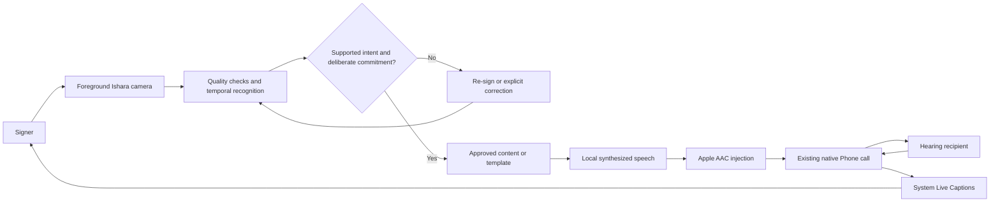

# Ishara working user workflow

**20 October update:** the [proposed recognition and call flow](<reports/Ishara proposed flow.md>)
and its Eraser diagrams incorporate mandatory Bolna speech orchestration, current
recognition research, and explicit approval before speech. The older local-TTS-only
diagram below is historical and does not satisfy the current Bolna requirement.

Research state: **18 October 2026.** This is a provisional workflow for discovery, not an approved architecture or implementation specification. Read the [research entrypoint](RESEARCH.md) and [evidence ledger](CLAIM-LEDGER.md) for qualifications.

## User and goal

The working persona is an **adult ISL signer who has a smartphone and wants to communicate directly with a hearing person**. The user calls through ordinary Phone/Contacts, from their existing number, and Ishara mediates that same cellular call. The hearing person needs no Ishara app. Bolna-originated PSTN calls, calling Bolna before the clinic, callbacks, forwarding schemes and second-call bridges are excluded.

The demo device is an iPhone 17; installed iOS is unknown. Clinic appointment conversation remains a candidate bounded demonstration. A successful demo must show the supported exchange faithfully rather than claim unrestricted sign translation or Deaf-community validation.

| Provisional assumption | Why it matters | What could challenge it |
|---|---|---|
| The user can read captions in a chosen language | System captions are the candidate return channel | Preferred written language and reading pace are unknown; spoken mother tongue does not establish written preference |
| A propped phone is usable | Both hands, upper body and face need framing | Distance, environment, mobility, posture and caption legibility |
| Opening Ishara after calling is acceptable | Avoids replacing Phone or claiming automatic camera takeover | App switching may interrupt capture or increase effort |
| Bounded supported intents can cover the demonstration | Limits recognition and output risk | Unexpected receptionist questions, names, dates and alternative slots |
| Rare deliberate repair is preferable to repeated Send actions | Preserves conversational flow | Automatic wrong speech could be less tolerable than confirmation |

No Deaf participant, interview or usability study is available. Online accessibility and language sources can inform assumptions; held-out dataset evaluation can test recognition. Neither establishes that this interaction is natural, acceptable or linguistically correct for the persona. Record the actual demo performer and avoid presenting hearing reenactments as participant validation. See [platform/workflow evidence](<research_notes/Ishara feasibility research/ios-and-workflow.md>) and [recognition evidence](<research_notes/Ishara feasibility research/recognition-and-models.md>).

## Preserve the existing call and expose necessary additions

| Stage | Existing calling action | Proposed Ishara addition | Still unverified |
|---|---|---|---|
| One-time setup | Normal carrier service and contacts | Enable Add Audio in Calls; grant app speech-injection and camera permissions; enable supported system Live Captions; select readable language and privacy/retention preference | Exact OS, setting persistence, language options, system prompts |
| Start | Choose contact and call in Phone/Contacts | Open/return to Ishara explicitly; place phone so signing space and captions are usable | Camera/session continuity, shortcut feasibility; no automatic launch promised |
| Converse | Hear/read the other person and respond | User reads system caption overlay, signs; supported completed intent becomes approved speech through AAC | Full simultaneous media behavior, boundaries and remote audibility |
| Repair | Repeat, clarify or correct | Re-sign or select a candidate only when needed; cancel pending speech; deliberately correct speech already heard | Gesture intent, correction burden, duplicate suppression |
| Finish | Hang up using native Phone/system controls | Ishara stops capture/output and clears pending work when call ends or user stops it | Call-state observation and cleanup behavior |

An Ishara **Stop capture** control is separate from **Hang up**. No supported authority for Ishara to end the unrelated existing cellular Phone call was established. Native mute also mutes injected speech. The consulted AAC docs do not promise room-microphone suppression, so pressing ordinary Phone mute cannot be the noise-management solution.

## Bounded conversation and repair

The candidate dialogue starts with a supported introduction and appointment inquiry, lets the receptionist respond, supports a deliberately expressed answer, and ends with the user checking the final details. This is a coverage target to audit, not an already supported script. The app must not mark a booking confirmed merely because its outgoing text sounds conclusive.

| Situation | User-owned action | What Ishara can responsibly do | Missing coverage to resolve |
|---|---|---|---|
| Ask about an appointment | Sign a supported intent; optionally approve call purpose/details before calling | Emit an approved sentence whose meaning is grounded in observed input | Suitable natural ISL phrase examples and variants |
| Receptionist proposes another time | Read system captions and deliberately accept/reject or express a time | Speak only the supported observed response; use preapproved details only where they remain valid | No incoming transcript tells the model the newly offered slot |
| Receptionist asks for a name or unexpected information | Supply a supported response or signal inability/repair | Abstain instead of guessing personal details | Name/number input, fingerspelling coverage and deliberate fallback |
| Recognition is uncertain | Re-sign or select a candidate | Remain silent until adequate evidence or explicit selection | Threshold calibration and candidate recall |
| User signs an unknown phrase, adjusts the camera or rests | No communication is necessarily intended | Keep unknown/no-sign separate from supported utterances | Rejection and continuous-boundary evaluation |
| An incorrect phrase is pending | Cancel/correct before playback | Remove pending audio/text | Commitment-window timing |
| An incorrect phrase has already played | Deliberately correct it | Stop remaining queued output and speak an approved correction | The already-heard phrase cannot be retracted |
| Capture/app/network is interrupted | Notice the interruption and resume deliberately | Clearly expose paused capture; prevent stale or duplicate output | Actual interruption recovery |
| Call ends | Use native hangup | Stop pending output and capture appropriately | No cross-session leakage |

A casual nod or shake must not automatically become consent. Head movement can be linguistic or incidental. The app also cannot infer that “a yes/no question just arrived” from a system overlay it cannot read. State gating must rely on actual app-known evidence or explicit user input.

## Conceptual data flow, not frozen architecture

The diagram describes a candidate composition. It does not assert that the device gate has passed. There is deliberately **no arrow from system captions or remote Phone audio into Ishara**. Optional Jev frame verification would add a disclosed cloud-image path; optional Laya decisions would consume supported text/state, not unseen receptionist content. A non-telephony external speech provider is an independent qualification branch; no standalone Bolna synthesis endpoint was established.

| Ishara can know if implemented and validated | Ishara cannot presently assume it knows |
|---|---|
| Captured sign observations and framing/recognition state | Remote Phone audio or a live app-readable transcript |
| User-selected scenario and explicitly approved profile/appointment details | Receptionist's offered time, current question or agreement |
| Its own candidate, pending, committed and playback states | What the recipient actually understood or whether booking completed |
| Observed system call-state changes where supported | Authority to hang up any unrelated Phone call |
| Available AAC injection state | Guaranteed caption visibility, accuracy or translated return channel |

## Vocabulary follows the exchange

The historical **25 signs + two head gestures** inventory is written out in the [recognition note](<research_notes/Ishara feasibility research/recognition-and-models.md>). It is a candidate inventory, not a frozen requirement. APPOINTMENT was supplied by the selected scenario, not a classifier label. Date/time selection before a call does not solve changed times or unexpected questions during it.

Audit each concept for dialogue utility, exact meaning/variant, licensed examples, signer/session coverage, continuous or isolated context, and unknown/repair behavior. Do not force the user to sign in English word order or equate concatenated isolated labels with ISL translation. Phrase/sentence resources exist, but suitability for this conversation is unverified. If only separated signs are feasible, expose the added pauses/actions and obtain an explicit scope decision rather than describing it as seamless natural signing.

## Adjacent mode and next decision

Face-to-face communication can use the app's own microphone and ASR for in-app captions, with camera/TTS and echo handling. It avoids the unrelated-call audio restriction but remains a separate mode with its own validation. It must not silently replace the call-first requirement.

Proceed through the [validation gates](VALIDATION-PLAN.md), then resolve the [founder questions](<reports/Ishara feasibility research.md#unresolved-founder-questions>). Requirements, architecture, tickets and build remain subsequent phases.
