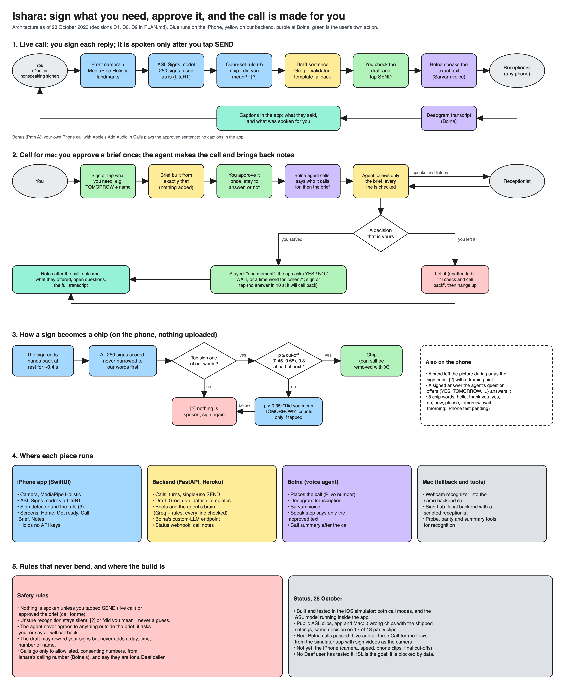

# Architecture board

The board as of 28 October 2026 (status after the first real calls), after decisions D8 (pure ASL with a published model, used as
is) and D9 (the "Call for me" mode). Five parts, top to bottom:

| Part | What it shows |
|---|---|
| 1. Live call | Sign → on-device recognition → chip → draft → SEND → Bolna's voice in the call → captions back |
| 2. Call for me | Signed request → brief → one approval → the agent's call → a question for the user (attended) or a callback promise (unattended) → notes |
| 3. Sign to chip | The open-set rule on the phone: chip, "did you mean", or [?] |
| 4. Where each piece runs | iPhone app, backend, Bolna, Mac tools |
| 5. Rules and status | The safety rules, and what has and hasn't run |

## Files

| File | What |
|---|---|
| `board.py` | The board's content and layout; writes the `.excalidraw` and `.svg` files. **Edit this**, not the drawing |
| `ishara-board.excalidraw` | Editable copy for [excalidraw.com](https://excalidraw.com) (menu → Open) or the VS Code extension |
| `ishara-board.svg`, `ishara-board.png` | The rendered board; the PNG is the SVG rendered at 2× (commands in `board.py`) |

[PLAN.md](../../../PLAN.md) wins if the board and the plan disagree; update both together.
The 23 October board (personalised ISL with SignCLIP, the day-by-day build lanes and the app
mock-ups) is in the [archive](../2026-10-23-ishara-board.png).
