# Demo script (3 minutes)

Written 28 October 2026 for the 31 October submission. Two parts:
**(a) Call for me, attended** (about 2 minutes) and **(b) a short live-mode exchange**
(about 1 minute). [Slides](SLIDES.md) · [Submission text](SUBMISSION.md) ·
[Demo-day runbook](RUNBOOK.md) · [Plan](../../PLAN.md) ·
[Handoff](../handoffs/2026-10-26-ready-made-asl-recognizer.md)

> **Status, 28 Oct.** Every line below was checked against the code and run through the
> real backend code with its scripted receptionist (`backend/scripts/local_demo.py`; no
> Bolna, no Groq, nothing dialled). **Pending:** no real Bolna call has been placed yet
> ([voice record](../experiments/voice.md) says "Not yet run"), nothing has run on an
> iPhone, the D9 endpoints are not on Heroku yet, and the recognition thresholds are still
> provisional (the phone-clip gate is not done). Until those land, part (a) and (b) can only
> be shown in the simulator or with the local backend, not as a live call.

## Cast and set-up

| Who | Does what |
|---|---|
| **Presenter** (hearing; learned the signs from Lifeprint) | Signs to the iPhone (or plays saved clips in the simulator) and taps on screen |
| **Receptionist** (a consenting teammate on their own phone, number in `ALLOWED_RECIPIENTS` as contact `clinic`) | Reads the receptionist lines below, word for word, from a printed card |
| **Narrator** (optional) | Says the narration lines while the call runs |

App settings for both parts: contact **City Clinic**, purpose **Doctor's appointment**, name
**Riya** (the app's built-in synthetic profile; no callback number, no reason).

## How a line was checked

Every quoted line has a source. "Ran" means it came out exactly like this from
`local_demo.py` (rule brain, template drafts, `--delay 0.3`) driven over the app's own
WebSocket messages on 28 Oct; "UI" means the string is in the SwiftUI view code and was seen
in a simulator screenshot.

| Kind of line | Comes from |
|---|---|
| Receptionist lines | [PLAN §1](../../PLAN.md#the-demo-story-the-script-we-rehearse) turns 2 and 4, the same strings as `RECEPTIONIST_LINES` in `backend/fakes/scripted_call.py` |
| The voice's fixed lines (disclosure, goodbye) | `DISCLOSURE`, `GOODBYE` in `backend/app/markers.py`; the disclosure is the Bolna agent's welcome message (`backend/bolna/agent.json`) |
| The agent's lines in Call for me | `PAUSE_LINE`, `CALLBACK_LINE`, `RuleBrain.opening` and `_options_for` in `backend/app/delegate.py`; the opening always comes from the rule brain (`_open_delegate` in `backend/app/calls.py`) |
| Live-mode drafts | `compose_template` in `backend/app/templates.py` (the template fallback) |
| On-screen text | `ios/Ishara/Views/…` |

**With `GROQ_API_KEY` set (as on Heroku), some wording can differ:** live drafts may be
reworded by Groq (still checked by the validator, template if rejected or slower than
1.5 s), and in Call for me Groq may phrase the agent's free lines and the offered time inside
the yes/no options (every free line passes `check_line`). The fixed lines (disclosure,
"One moment, please.", the callback line, goodbye) never change. **Groq's wording for these
exact turns is unmeasured**; the lines below are the template / rule-brain floor.

---

## Part (a): Call for me, attended (about 2:00)

```
sign TOMORROW · MORNING ─▶ brief ─▶ Approve and call ─▶ disclosure + opening ─▶ receptionist offers 4 pm
      ─▶ "One moment, please." ─▶ AskCard ─▶ sign or tap YES ─▶ agent says it ─▶ hang-up ─▶ notes
```

| Time | Screen / action | Said on the call | Source |
|---|---|---|---|
| 0:00 | **Home** ([01](img/01-home.png)). Narrator: *"Riya is Deaf. She needs a doctor's appointment, and the clinic only takes phone calls."* The note under the buttons reads: *"Calls are placed from Ishara's calling number, not your own number. The receptionist hears an automated voice reading what you approve."* Narrator adds: *"That number is Bolna's, not Riya's."* | — | UI (`HomeView`); Bolna number: PLAN §9 |
| 0:10 | Tap **CALL FOR ME** → **Get ready** ([02](img/02-get-ready.png)): face, hands and light checks → **I'm ready, sign my request** | — | UI (`GetReadyView`, `AppRootView`) |
| 0:20 | **Call for me** screen ([03](img/03-request-chips.png)): *"Sign what you need"*. Sign **TOMORROW**, rest, sign **MORNING**. MORNING is only a candidate word: if a *"Did you mean MORNING?"* tile shows, tap **Use it**; if a red `?` shows, tap **morning** under *"Or tap:"* | — | UI (`BriefView`, `CandidateTile`); word status: handoff "Vocabulary and script" |
| 0:40 | Tap **Prepare the request**. The brief appears ([04](img/04-brief.png)) under *"The agent follows only this brief with City Clinic"*: *"Call on behalf of Riya, who is Deaf and uses the Ishara app, to book a doctor's appointment. Preferred: tomorrow in the morning. May share: name (Riya). Will not agree to anything outside this brief; anything else comes back to you as a question."* Leave **I'll stay and answer questions** on. Narrator: *"She approves this once. The agent can't agree to anything outside it."* | — | Ran (`build_brief`); UI |
| 0:55 | Tap **Approve and call**. Call screen: *"The agent is making the call for you. When a decision is yours it will ask here: sign or tap yes, no or wait."* | (ringing) | UI (`SigningPanel`) |
| 1:00 | Captions show the voice's lines as *Ishara (voice)* | **Voice:** "Hello, I'm calling for a Deaf caller who is using Ishara, a sign-language app. Their replies may take a few seconds." | Ran; `markers.DISCLOSURE` |
| 1:08 | | **Voice:** "I'd like to book a doctor's appointment for Riya, tomorrow in the morning." | Ran; `RuleBrain.opening` |
| 1:14 | Caption *Receptionist* | **Receptionist:** "We have 4 pm tomorrow. Does that work?" | PLAN §1 turn 2 |
| 1:18 | **AskCard** ([05](img/05-ask-card.png)): *"The agent is asking you"*, the question, and three options with the exact sentence each one says: **YES** "Yes, 4 pm tomorrow works. Thank you." · **NO** "No, 4 pm tomorrow doesn't work, sorry. Is there another time?" · **WAIT** "One moment, please, I'm checking." Footer: *"No answer in 10 s: the agent says “I'll need to check that and call back. Thank you.”"* | **Voice:** "One moment, please." | Ran (`PAUSE_LINE`, `_options_for`, `ASK_TIMEOUT_S`, `CALLBACK_LINE`); UI (`AskCard`) |
| 1:22 | Sign **YES** (or tap **YES**). Narrator: *"Riya decides, not the agent."* | **Voice:** "Yes, 4 pm tomorrow works. Thank you." | Ran |
| 1:30 | The brief is settled, so the agent hangs up by itself about 6 s later (`END_AFTER_DONE_S`). The receptionist says nothing more | **Voice:** "Thank you for your time. Goodbye." | Ran; `markers.GOODBYE` |
| 1:40 | *"The call ended"* → **See the call notes** → **Call notes** ([07](img/07-notes.png)): outcome **Booked**; *"What happened"*: "Goal: book a doctor's appointment for Riya." · "They offered: "We have 4 pm tomorrow. Does that work?"" · "You answered: "Yes, 4 pm tomorrow works. Thank you.""; then *"The brief you approved"* and the *"Transcript"* | — | Ran (`build_notes`, outcome `booked`); UI (`NotesView`) |
| 1:55 | Narrator: *"If Riya puts the phone down instead, the agent never decides for her: it says it will call back."* | (unattended only) "I'll need to check that and call back. Thank you." | Ran (unattended run, outcome `callback`) |

Notes for the presenter:

- **Don't let the receptionist say line 2** ("Yes, 10:30 tomorrow morning.") in part (a). After
  the YES the call is settled and the agent says nothing new, but a second offer would show up
  in the notes as a second "They offered" line. In the local run the scripted receptionist
  says it anyway, and the notes list it.
- The simulator's built-in **fake call** (demo mode, the screenshots here) plays a different,
  self-contained script: the receptionist offers *"We have 10:30 tomorrow morning. Does that
  work?"*, confirms *"Great, you're booked for 10:30 tomorrow morning."* and the voice closes
  with *"Thank you for your help. Goodbye."* (`ios/Ishara/Call/DelegatedDemo.swift`). The
  backend wording above is what a real call uses. If the demo falls back to the fake call,
  read the receptionist's lines from the screen, not from the card.
- If the offer comes while Bolna is still speaking, Bolna may skip the line (ledger B24); the
  app then shows *"Not delivered"* and nothing is resent on its own. Unmeasured on a real call.

### Variant (verified, not the default): NO first, then YES

Uses both PLAN §1 receptionist lines and fits the brief's "morning". Adds about 20 s.

| Said on the call | Source |
|---|---|
| **Receptionist:** "We have 4 pm tomorrow. Does that work?" → **Voice:** "One moment, please." → user signs **NO** → **Voice:** "No, 4 pm tomorrow doesn't work, sorry. Is there another time?" | Ran |
| **Receptionist:** "Yes, 10:30 tomorrow morning." → **Voice:** "One moment, please." → AskCard **YES** "Yes, 10:30 tomorrow works. Thank you." → user signs **YES** → **Voice:** "Yes, 10:30 tomorrow works. Thank you." → about 6 s later "Thank you for your time. Goodbye." | Ran; notes outcome `booked` |

---

## Part (b): live mode, the user signs every reply (about 1:00)

The handoff's live-mode script: **hello** → receptionist offers a slot → **no · tomorrow ·
please** → "10:30 tomorrow morning" → **yes · thankyou**. Nothing is spoken until the
presenter taps **SEND**.

| Time | Screen / action | Said on the call | Source |
|---|---|---|---|
| 2:00 | Home → **CALL** → Get ready → **I'm ready, start call** | **Voice:** "Hello, I'm calling for a Deaf caller who is using Ishara, a sign-language app. Their replies may take a few seconds." | Ran; UI |
| 2:08 | Sign **HELLO** → chip `hello`, draft card with a **Template** badge: "Hello." → tap **SEND** (*"Speaking now…"*, then *"✓ Delivered"*) | **Voice:** "Hello." | Ran (`compose_template`) |
| 2:15 | | **Receptionist:** "We have 4 pm tomorrow. Does that work?" | PLAN §1 turn 2 |
| 2:20 | Sign **NO**, **TOMORROW**, **PLEASE**. If TOMORROW comes up as *"Did you mean TOMORROW?"* ([10](img/10-live-pick-one.png)), tap **Use it**. Draft: "No, sorry, that doesn't work. Is there anything tomorrow? Please." → **SEND** | **Voice:** "No, sorry, that doesn't work. Is there anything tomorrow? Please." | Ran |
| 2:35 | | **Receptionist:** "Yes, 10:30 tomorrow morning." | PLAN §1 turn 4 |
| 2:40 | Sign **YES**, **THANKYOU**. Draft: "Yes, that works. Thank you." → **SEND** | **Voice:** "Yes, that works. Thank you." | Ran |
| 2:48 | Tap **End** | **Voice:** "Thank you for your time. Goodbye." | Ran; `markers.GOODBYE` |
| 2:55 | Narrator: *"Every sentence was Riya's choice. A sign the model isn't sure about shows as a question mark and is never spoken."* (screens [11](img/11-live-unsure.png), [13](img/13-live-wrong-chip.png)) | — | UI |

Notes for the presenter:

- "Hello." on its own is short, because the call purpose is not signed: under D8 there is no
  ASL `doctor` in the model's 250 glosses, so the template can't say "a doctor's appointment".
  Groq sees the purpose and may word it more fully (unmeasured for this turn).
- An earlier live Groq run gave "Yes, 10:30 tomorrow morning works. Thank you." for
  `yes · thankyou` after the same receptionist line, in 0.17 s
  ([record](../experiments/video-pipeline-eval.md)); the template above is the fallback.
- If no one speaks for about 15 s while the presenter signs, the voice fills the gap with
  "One moment please, I'm signing my reply." (`markers.HOLDING_LINE`). Not a problem; keep going.
- The simulator's fake live call (demo mode) plays the older PLAN §1 script with `doctor`
  and a planned wrong chip ([13](img/13-live-wrong-chip.png)); it is good for showing the
  safety screens, not for part (b)'s exact words.

## Screens used above

All from the simulator, demo mode (fake call, nothing dialled), synthetic profile "Riya".

| | |
|---|---|
| 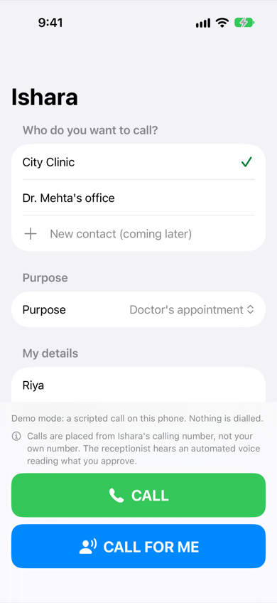 [01 Home](img/01-home.png) | 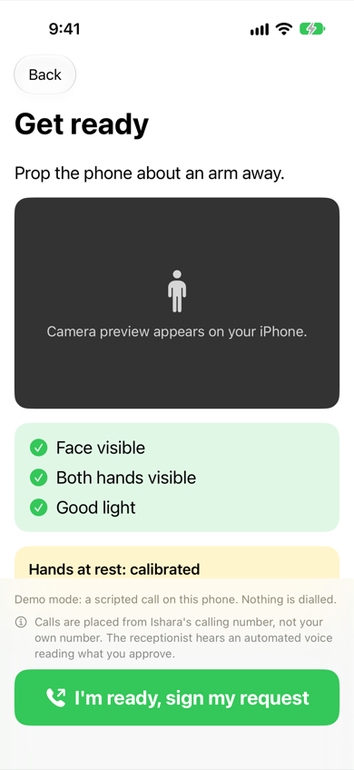 [02 Get ready](img/02-get-ready.png) (simulated checks) |
| 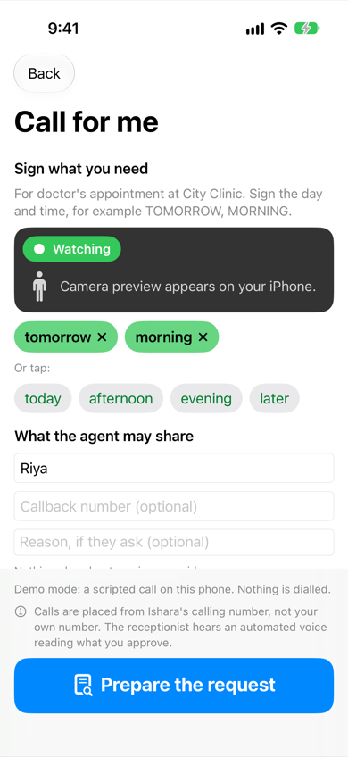 [03 Request](img/03-request-chips.png) | 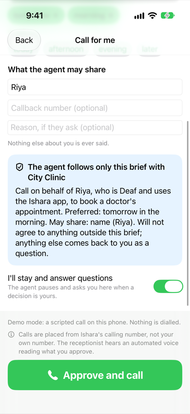 [04 Brief](img/04-brief.png) |
| 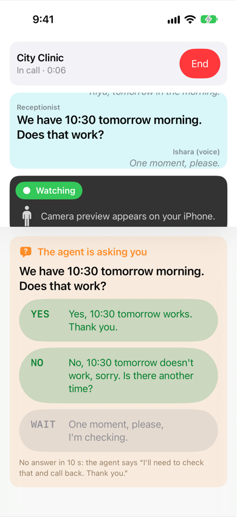 [05 AskCard](img/05-ask-card.png) (fake call: 10:30 offer) | 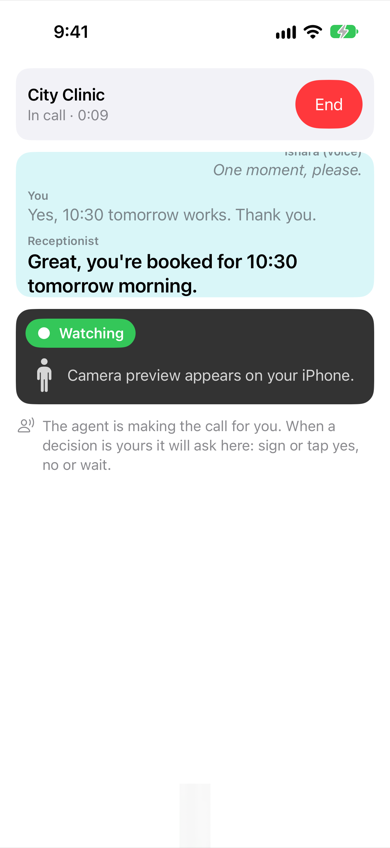 [06 After YES](img/06-after-yes.png) (fake call wording) |
| 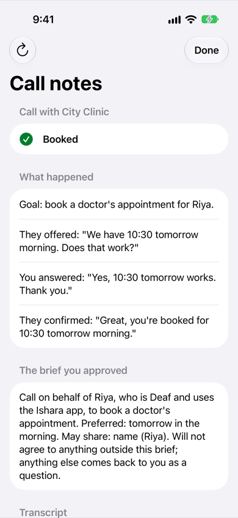 [07 Notes](img/07-notes.png) (fake call wording) | 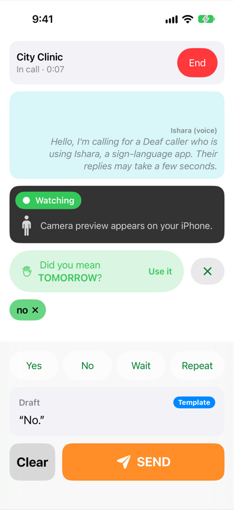 [10 Pick-one tile](img/10-live-pick-one.png) |
| 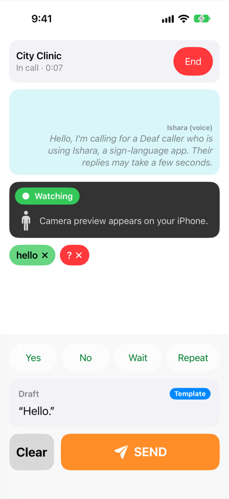 [11 `?` chip](img/11-live-unsure.png) | 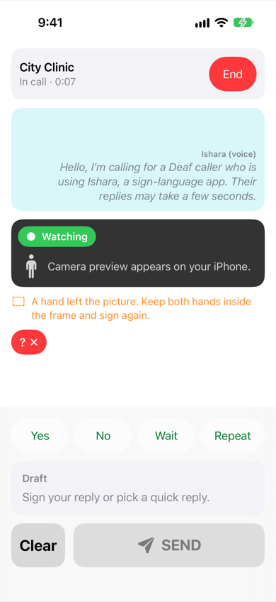 [12 Framing hint](img/12-live-hand-out-of-frame.png) |
| 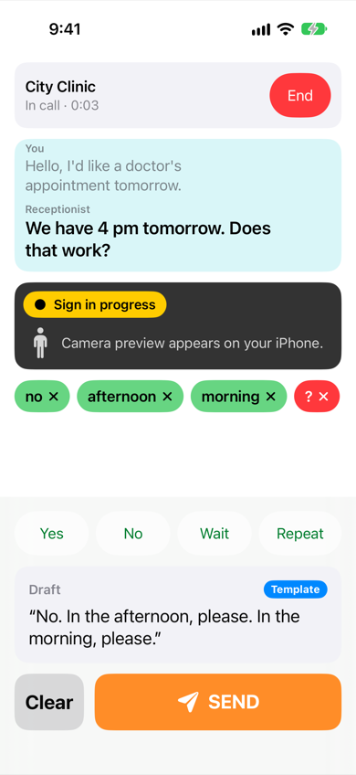 [13 Wrong chip, ✕ before SEND](img/13-live-wrong-chip.png) | 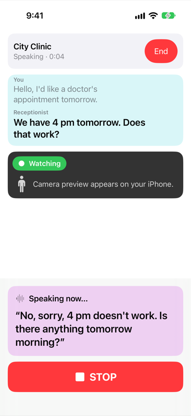 [14 STOP while speaking](img/14-live-speaking-stop.png) |
| 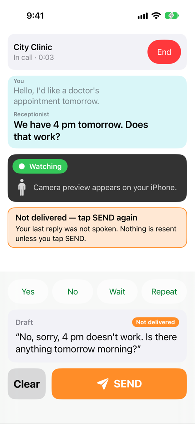 [15 Not delivered](img/15-live-not-delivered.png) | |

## Reproduce the check

```sh
cd backend
uv run python -m scripts.local_demo --port 8799 --delay 0.3     # free; prints what the voice says
```

Then drive it like the app: `POST /briefs` with chips `tomorrow, morning` and profile name
`Riya`, `POST /calls` with `mode=delegated, attended=true`, answer the `ask` with `yes`, and
read `GET /calls/{id}/notes`; for part (b), `POST /calls` (live) and send `chips` /
`approve` on the call WebSocket. The app does the same with `-IsharaDriver live` against this
server (see the `LocalBackendCallUITests` set-up), or `scripts/sign_lab.sh --free --model asl
-- --delegated --attended --name "Riya"` on the Mac.
