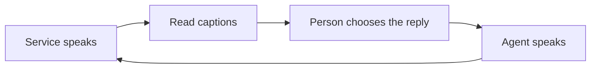

# Ishara — six-slide pitch outline

Updated 30 October 2026 · [Pitch](../../PITCH.md) · [Market model](../../MARKET.md) · [Submission](SUBMISSION.md)

One idea per slide. Show the app and the person during the live segment. The current build
demonstrates signs and tap choices; general typed replies are next.

## 1. “Call us” should not mean “find someone who can call for you”

**Visual:** an appointment line's “Call to book” instruction and someone coordinating
with a helper. This is an illustrative scenario, not a participant testimonial.

**Say:** “When a service requires a voice call, someone who cannot reliably hear the reply
may need another person available to help. An everyday task becomes a coordination problem,
and someone else enters the conversation.”

## 2. Phone calls, made accessible

**Say:** “Ishara makes the conversation readable and lets the person direct the reply.
The business answers its existing phone. It needs no new app.”

## 3. The person stays in the conversation

**Visual:** CALL and CALL FOR ME, then the actual live screen.

- Live call: review each draft and SEND it.
- Call for me: approve the brief; answer when a decision comes back.
- Product direction: type, sign or tap. Current build: signs and existing buttons.

**Demo:** “What time would you like?” → caption → sign or tap TOMORROW → spoken preference.
Show the incoming question and outgoing audio. Use a confirmed delegated-booking ending
only after the confirmation/hangup bug is corrected and verified. The live SEND flow can
instead demonstrate an explicit receptionist confirmation without that delegated hangup.

## 4. A large need, a focused starting point

| Reference | What it says |
|---|---|
| 70M+ Deaf people globally | UN, citing WFD |
| 430M people requiring rehabilitation for disabling hearing loss | WHO, March 2026; overlaps the first population |
| $210M/year illustrative TAM scenario | 3.5M eligible accounts at $5/month; eligibility and price are assumptions |

**Say:** “The need is large. Our first task is one accessible appointment call. We must
earn repeat use and validate affordability. Our scenarios are transparent assumptions,
not our user base.” Put [sources and model](../../MARKET.md) beside the figures.

## 5. A route to sustainable access

**Visual:** people → individual or sponsored accounts → existing phone lines.

**Say:** “Start with recurring service calls. Test distribution through Deaf-led
organizations and accessibility programs, and individual or sponsored accounts with
metered calling. The business case depends on independent completion and cost per task.”

Captioned calls and text relay already exist. The hypothesis is that approved delegation
and accessible mid-call steering reduce effort. No comparative advantage, paying users
or partners have been established.

## 6. Your conversation. Your control.

**Visual:** the actual question, the person's choice and the corresponding spoken reply.
For a booking claim, show the receptionist's actual confirmation.

**Say:** “The prototype uses a small ASL vocabulary and tap choices. I am hearing and
learned these signs from Lifeprint; we have no Deaf-participant validation yet. Calls
come from a Bolna number. Next are participant-led evaluation, typing, reliability,
and separate ISL evaluation. Our goal is independent access to the services people need.”

Close: **“Ishara: phone calls, made accessible.”**

## Delivery notes

- Put citations and assumptions beside numbers, not only in speaker notes.
- Do not describe Deaf people as unable to speak or assume everyone signs.
- Label teammate rehearsals, synthetic details, simulator footage and saved-video input.
- Acceptance is not confirmation; text handoff is not completed audio playback.
- Architecture in one sentence: “Bolna carries the call; Ishara connects captions,
  person-controlled replies and an approved brief.”
- Finalize device and recognition claims from the recorded build before submission.
