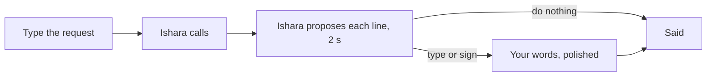

# Ishara — six-slide pitch outline

Updated 31 October 2026 · [Pitch](../../PITCH.md) · [Market model](../../MARKET.md) · [Submission](SUBMISSION.md)

One idea per slide. Show the app during the demo segment.

## 1. "Call us" should not mean "find someone who can call for you"

**Visual:** a clinic's "Call to book" line, and the family member who ends up making the call.

**Say:** "Every clinic, bank and office says the same thing: call us. If you can't hear the
other side, a two-minute call becomes a favour: on someone else's time, with your private
details in their ears."

## 2. The scale

| Figure | Source |
|---|---|
| 70M+ Deaf people use a sign language | UN, citing WFD |
| 430M live with disabling hearing loss | WHO |
| 50 lakh Deaf people in India; fewer than 300 certified ISL interpreters | ISLRTC, Census 2011 |

**Say:** "In India, that's one certified interpreter for every 17,000 Deaf people."

## 3. Ishara makes the call; you stay in control

**Say:** "Type what the call is about and tap Call. Ishara introduces itself, speaks for
you and captions every word. Do nothing, and it handles the call. Step in any time, by
typing or signing, and it says your words, polished but never embellished."

## 4. Live demo

The clinic call: Ishara turns down a 4 pm slot because you asked for mornings; you tap its
line and add "I'll bring my BP readings"; it answers the allergy question from your health
history PDF; you sign THANK YOU; the gist opens with the booking quoted.

## 5. Under the hood

**Visual:** the [architecture diagram](../media/architecture-light.svg).

**Say:** "On the iPhone, MediaPipe and a public ASL model recognise signs, and speak only
when they're confident. Our backend decides every turn, and a fact-checker blocks anything
you didn't give it: no invented day, time, number or name. Bolna runs the call: Deepgram
listens, Sarvam speaks, Plivo connects. The clinic just answers its phone."

## 6. The business: your conversation, your control

| | Per minute |
|---|---|
| Human video relay (US) | $4.07–$8.06 |
| AI voice agent | from $0.06 |

**Say:** "The US spends $1.48 billion a year on phone relay. An AI minute costs cents, so
an accessible call can be a subscription, not a subsidy. We start in India, with Deaf-led
partners, Indian Sign Language and Indian languages next."

Close: **"Ishara: phone calls, made accessible."**

## Delivery notes

- Put the source beside every number.
- Don't describe Deaf people as unable to speak, or assume everyone signs.
- Calls come from Ishara's calling number (a Bolna number); say so if asked.
