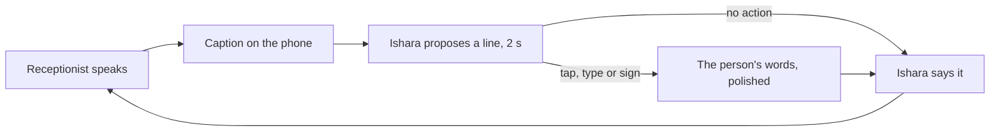

# Ishara — submission copy

Updated 31 October 2026 · [Product and architecture](../../README.md) · [Pitch](../../PITCH.md) · [Market model and sources](../../MARKET.md)

## Project description — under 200 characters

Ishara makes phone calls for Deaf people: an AI agent speaks for you and captions every word, and you steer it any time by typing or signing. The business just answers its phone.

## The problem

Clinics, banks and offices still say "call us". For someone who can't hear the reply, a
two-minute call depends on another person being free, and puts that person inside a
private conversation. Typing alone doesn't solve it, because the other side is talking.

Ishara gives the call back to the person it belongs to. Deafness does not imply an
inability to speak, and signing is optional: people steer by typing, signing, or both.

## What we built

One flow, where the agent does the work by default and the person takes over at will:

- **Before the call:** a +91 number (or a contact), the request in the person's own words,
  and attachments such as a health-history PDF, read on the phone.
- **During the call:** Ishara introduces itself, states the request in its own words and
  handles each turn. Its next line appears with a **2-second bar**; left alone, it's said.
  It accepts only offers that fit the request, answers from the person's documents word for
  word when asked, and defers anything else as a follow-up.
- **Stepping in:** tap Ishara's line to change it, type a reply, or sign. Ishara polishes
  the words without adding facts, previews them for 1.5 seconds, then says them, and covers
  the pause while the person composes.
- **After the call:** the gist opens with what was agreed (quoted), who answered what,
  follow-ups and the transcript. A Live Activity shows the call on the lock screen.

## How Bolna is used

Bolna places the call and runs a graph agent whose LLM is our FastAPI backend, so every
word Ishara speaks comes from our rules: Deepgram transcribes the other side, Sarvam Bulbul
speaks, Plivo carries the line. The backend uses Groq (`openai/gpt-oss-120b`) to phrase the
opening and polish the person's words; a validator blocks any invented day, time, number or
name, with deterministic templates as the fallback. On the iPhone, MediaPipe and the
published Kaggle ASL Signs model recognise signs through LiteRT.

The backend runs on Heroku. Calls come from Ishara's calling number (a Bolna number), not
the person's own number, and Ishara says who it is at the start of every call.

## Opportunity

**70M+ Deaf people** use a sign language worldwide (UN, citing WFD); **430M** live with
disabling hearing loss (WHO); India has about **50 lakh** Deaf people and **fewer than 300**
certified ISL interpreters (ISLRTC). In the US, phone relay is funded at **$1.48B a year**,
and a human video relay minute costs **$4.07–$8.06**, against **from $0.06** for an AI voice
agent minute. Sources: [MARKET.md](../../MARKET.md#sources).

Ishara starts in India with individual and sponsored subscriptions. A global scenario of
**3.5M accounts × $5/month = $210M/year** illustrates the scale; eligibility and price are
planning assumptions.

## Signing

Recognition runs on the iPhone with the public Kaggle ASL Signs first-place model (250
signs, trained on about 94,000 clips from 21 Deaf signers). Ishara shows a word only when
the model is confident; anything else is never spoken. The signs in the app today are
hello, thank you, yes, no, now, please, tomorrow and wait. ASL and Indian Sign Language
are separate languages; ISL comes next, with Deaf partners and ISL data.

## Next

Indian Sign Language and more signs; Hindi and regional languages through Sarvam; calls
from the person's own number; pilots with Deaf-led organisations to measure independent
completion, input preference and repeat use.

## Credits

Bolna, Deepgram, Sarvam, Plivo, Groq, MediaPipe and LiteRT. Recognition uses the published
Kaggle ASL Signs first-place model, with attribution to its authors and corpus contributors.
Lifeprint supplied sign-learning references. Source and asset licenses remain applicable.
