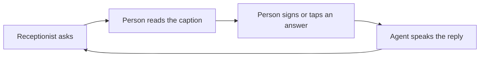

# Ishara — submission copy

Updated 30 October 2026 · [Pitch](../../PITCH.md) · [Market model and sources](../../MARKET.md)

## Project description — under 200 characters

Ishara helps Deaf people handle phone calls independently: read captions, approve spoken replies, or steer a voice agent through an approved brief and accessible mid-call choices.

## The problem

At a service whose next step is “Call us”, someone who cannot reliably hear the reply may
need another person available to help. An everyday task can depend on a second schedule
and put another person inside a private conversation.

Ishara aims to make those calls independently accessible. Incoming speech becomes captions;
the person directs replies or authorizes an agent to pursue a bounded request. The business
uses its ordinary phone. Signing is an optional input; people who prefer typing or buttons
belong in the same product experience. Deafness does not imply an inability to speak.

## What we built

- **Live relay:** supported signs become editable word chips and a draft. The person
  reviews it and taps SEND before the reply is supplied to the voice service. Existing
  quick replies also require SEND.
- **Call for me:** approve a brief once. In attended mode, captions and supported sign/tap
  choices let the person steer decisions. An open “What time would you like?” question
  can be answered with TOMORROW while the agent stays on the call. In unattended mode,
  unsupported decisions lead to a callback requirement.
- **Follow-up:** captions, transcripts, delegated notes, and Recent calls stored on the phone.

**General typed replies and camera-free entry are planned, not shipped.** The prototype
currently demonstrates signs, buttons and limited text fields in the brief.

## How Bolna is used

Bolna places the call, runs the graph agent and calls our FastAPI custom-LLM endpoint.
Graph events connect approved replies to speech. Deepgram transcribes, Sarvam supplies
the voice, and Plivo carries the phone line. Groq composes drafts with checks and
deterministic fallback. MediaPipe and a published ASL model run on the iPhone through LiteRT.

**Calls originate from a Bolna number, not the person's own number.** The trial account
only dials verified recipients. Demonstration calls use an allowlisted consenting teammate
and synthetic details.

## Opportunity

The UN cites **70M+ Deaf people globally**. WHO reports **430M people requiring rehabilitation
for disabling hearing loss**. These populations overlap and are not customer counts.
Sources and dates: [MARKET.md](../../MARKET.md#sources).

An illustrative global scenario is **3.5M eligible accounts × $5/month = $210M/year** in
subscription revenue. Eligibility assumes 5% of the 70M reference population; both that
fraction and price are unvalidated. The initial India-first opportunity depends on usable
language/input coverage and reliable calls. Individual access and sponsored accounts with
metered calling are models to test. No paying users, partnerships or commercial deployments
are claimed.

## Demonstration and current limits

The team recorded real Bolna calls on 28 October through the simulator with sign videos
as input: live relay, attended and unattended delegation, and an open time question. This
is rehearsed integration evidence with a teammate, not participant validation.

- The recognizer permits eight isolated ASL words. It does not translate continuous signing.
  MORNING is tap-only; arbitrary clock times cannot be signed.
- ASL and ISL are separate languages. ISL needs suitable data and its own evaluation.
- No Deaf participant has validated the app. The presenter is hearing and learned the
  demonstrated signs from Lifeprint.
- Physical iPhone camera/performance and final thresholds remain unverified in the available
  evidence. Label simulator footage and clip replay.
- Booking outcomes and early hangup need hardening: acceptance is not confirmation.
  Delivered currently means text handoff, not completed audio. State is process-local,
  with limited restart recovery.
- Output checks reduce selected model errors; they do not prove arbitrary factual correctness.

Update claims only after verification. A badge is not independent proof of a clinic booking.

## Next

Participant-led validation of independent completion and input preference; general typed
replies and camera-free entry; confirmation, delivery and recovery hardening; then bounded
ISL evaluation with Deaf partners. The goal is reliable accessible calls with a choice of input.

## Credits

Bolna, Deepgram, Sarvam, Plivo, Groq, MediaPipe and LiteRT. Recognition uses the published
Kaggle ASL Signs first-place model, with attribution to its authors and corpus contributors.
Lifeprint supplied sign-learning references. Source and asset licenses remain applicable.
